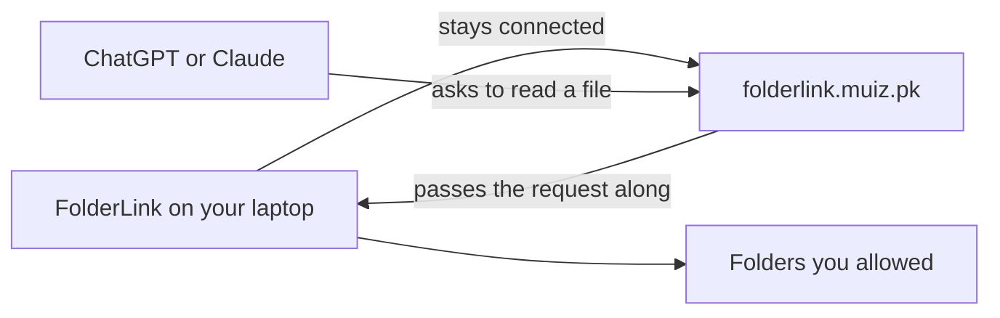

<div align="center">
  <picture>
    <source media="(prefers-color-scheme: dark)" srcset="docs/brand/logo-lockup.svg">
    <source media="(prefers-color-scheme: light)" srcset="docs/brand/logo-lockup-light.svg">
    
  </picture>
  <p><strong>Your folders. Your AI.</strong></p>
  <p>Let ChatGPT, Claude and other AI apps read the project folders you choose, right from their website. No uploads, no copy-paste. Read-only, logged, and revocable in one click.</p>
  <p>
    <a href="https://github.com/mmuizahmed/mcp-bridge/actions/workflows/ci.yml"></a>
    <a href="LICENSE"></a>
    <a href="https://github.com/mmuizahmed/mcp-bridge/releases"></a>
    <a href="https://go.dev/"></a>
  </p>
  <p>
    <a href="https://folderlink.muiz.pk">Website</a>
    ·
    <a href="docs/ARCHITECTURE.md">Docs</a>
    ·
    <a href="docs/SELF-HOSTING.md">Self-host</a>
    ·
    <a href="SECURITY.md">Security</a>
  </p>
</div>


## Why FolderLink

- You stop pasting whole projects into a chat.
- A file leaves your laptop only when an AI app asks for it.
- Secrets such as `.env`, keys, and certificates are always blocked.
- It works with the free ChatGPT plan. No extra subscription.

## How it works

1. Run FolderLink on your laptop and choose the folders it may read.
2. Pair the laptop at [folderlink.muiz.pk/pair](https://folderlink.muiz.pk/pair) with the code it prints.
3. Add the connector in ChatGPT or Claude. The address is `https://folderlink.muiz.pk/mcp`.



Your laptop calls out. Nothing on it accepts incoming connections. The AI app never picks a device. Your sign-in decides which laptop answers.

| Landing                             | Pair                                   |
| ----------------------------------- | -------------------------------------- |
|  |  |

## Quick start

Download the archive for your system from [GitHub Releases](https://github.com/mmuizahmed/mcp-bridge/releases). Each file is named `folderlink_<os>_<arch>`.

```bash
# macOS Apple silicon
curl -L -o folderlink.tar.gz https://github.com/mmuizahmed/mcp-bridge/releases/latest/download/folderlink_darwin_arm64.tar.gz
tar -xzf folderlink.tar.gz

# macOS Intel
curl -L -o folderlink.tar.gz https://github.com/mmuizahmed/mcp-bridge/releases/latest/download/folderlink_darwin_amd64.tar.gz

# Linux x86_64
curl -L -o folderlink.tar.gz https://github.com/mmuizahmed/mcp-bridge/releases/latest/download/folderlink_linux_amd64.tar.gz

# Linux arm64
curl -L -o folderlink.tar.gz https://github.com/mmuizahmed/mcp-bridge/releases/latest/download/folderlink_linux_arm64.tar.gz

# Windows: download folderlink_windows_amd64.zip from the same page
```

Then:

```bash
folderlink allow ~/projects/my-app --label my-app
folderlink
```

Open [folderlink.muiz.pk/pair](https://folderlink.muiz.pk/pair), enter the code, and turn the folder on. In ChatGPT or Claude, add a connector at `https://folderlink.muiz.pk/mcp`.

## Security

- Reads only. FolderLink cannot write files or run commands.
- The folder list is enforced on your laptop. The server cannot add a path.
- `.env`, keys, and certificates are refused by default.
- The laptop holds an Ed25519 device key. The server checks it on every connection.
- Access tokens are short-lived. You can revoke a device from the website.

Report a vulnerability through [SECURITY.md](SECURITY.md). The longer threat model is [docs/SECURITY-MODEL.md](docs/SECURITY-MODEL.md).

## Self-hosting

FolderLink runs on a free Cloudflare account: one Worker, one database, and the website as static files. The steps are in [docs/SELF-HOSTING.md](docs/SELF-HOSTING.md). Point your laptop at your own server with `folderlink --server https://your-host`.

## Development

```bash
pnpm install
pnpm lint
pnpm typecheck
pnpm test
```

Local worker, pairing, and MCP Inspector steps are in [docs/DEVELOPMENT.md](docs/DEVELOPMENT.md). Contribution rules are in [CONTRIBUTING.md](CONTRIBUTING.md).

## Project structure

| Path              | What it is                                                       |
| ----------------- | ---------------------------------------------------------------- |
| `apps/bridge`     | The FolderLink app. Pairing, reconnect, and the folder boundary. |
| `apps/worker`     | Cloudflare Worker. One record per laptop, plus the database.     |
| `apps/web`        | Website: landing, pair, and dashboard.                           |
| `packages/shared` | Message format shared by the website and the worker.             |
| `docs`            | Architecture, security, self-hosting, and the roadmap.           |

## Roadmap

Later: writing files, running commands, and asking before each action. The list is [docs/ROADMAP.md](docs/ROADMAP.md).

## License

[MIT](LICENSE).
