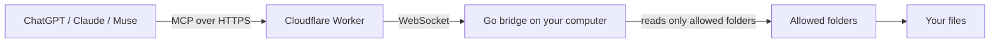

<div align="center">
  <picture>
    <source media="(prefers-color-scheme: dark)" srcset="docs/brand/logo-lockup.svg">
    <source media="(prefers-color-scheme: light)" srcset="docs/brand/logo-lockup-light.svg">
    
  </picture>
  <p><strong>Your folders. Your AI.</strong></p>
  <p>FolderLink lets ChatGPT, Claude, and Muse read files from your own computer. A file leaves your laptop only when an AI asks for it.</p>
  <p>
    <a href="https://github.com/mmuizahmed/folderlink/actions/workflows/ci.yml"></a>
    <a href="https://github.com/mmuizahmed/folderlink/releases"></a>
    <a href="LICENSE"></a>
    <a href="https://go.dev/"></a>
    <a href="https://m8ven.ai/mcp/mmuizahmed/folderlink?s=readme"></a>
  </p>
  <p>
    <a href="https://folderlink.muiz.pk">Website</a>
    ·
    <a href="https://folderlink.muiz.pk/dashboard">Dashboard</a>
    ·
    <a href="docs/ARCHITECTURE.md">Docs</a>
    ·
    <a href="SECURITY.md">Security</a>
  </p>
</div>


## Features

- **Ask about your own files.** "What does this function do?" gets an answer from the code on your disk, not from a paste.
- **You choose the folders.** Only folders you add are visible. The list is enforced on your laptop; the server cannot add a path.
- **Reads are the default.** Apps connect with the read-only `folderlink:read` scope; writes, deletes, and commands need your dashboard approval first.
- **Secrets stay put.** `.env` files, keys, certificates, and credential files are refused on your laptop before anything leaves it.
- **Every read is on the record.** The dashboard shows which app asked for which file.

## Quick start

Windows (PowerShell):

```powershell
irm https://folderlink.muiz.pk/install.ps1 | iex
```

macOS and Linux:

```bash
curl -fsSL https://folderlink.muiz.pk/install.sh | sh
```

The installer checks checksums and opens your browser to connect this computer. Then verify it:

```console
$ folderlink doctor
[OK] Background copy: background service is installed in ...
Everything looks good.
```

Add the connector in ChatGPT, Claude, or Muse:

```text
https://folderlink.muiz.pk/mcp
```

Then ask it about a file in a folder you shared. It answers from the file on your computer.

## Why FolderLink

Pasting a project into a chat works for one file. It breaks for a folder: the AI sees a stale copy, and the copy lives on someone else's server. FolderLink answers from the live files on your computer — but the trade-off is the relay: file contents pass through a Cloudflare Worker on the way to the AI app. A local-only MCP server avoids the relay but cannot serve the ChatGPT, Claude, or Muse website.

Do not use FolderLink for files that must never leave the machine in any form, even in transit to an AI provider you chose. Use a fully local setup for those.

## How it works



1. The AI app calls a tool at `https://folderlink.muiz.pk/mcp` with an OAuth token (scope `folderlink:read`), naming a folder and a path.
2. The Worker checks the token, finds the paired computer, and relays the request over the bridge's outbound WebSocket.
3. The bridge checks the folder against the list on your computer, refuses secrets, and reads the file from disk.
4. The answer travels back the same way: bridge → Worker → AI app.
5. Writes, deletes, and commands stop at step 3. The bridge answers `approval_required`, you approve in the dashboard, and the AI retries with the approval id. An approval is single-use, bound to the exact bytes, and expires after 24 hours (10 minutes to use once approved).

## Usage

Ask about code in a folder you shared:

> In the folder `folderlink`, what does `apps/bridge/internal/guard/deny.go` block, and why?

The AI reads the file and answers. No paste, no upload.

Change a file — with your approval:

> Fix the typo in `README.md` in `folderlink`.

The AI says the write needs approval. You review the diff, approve it, and the AI retries — the write lands only then.

## Installation

### Windows

```powershell
irm https://folderlink.muiz.pk/install.ps1 | iex
```

No administrator rights needed. The installer verifies the download against `checksums.txt`, installs to `%LOCALAPPDATA%\FolderLink`, adds it to your user `PATH`, and runs `folderlink install`, which starts it at login with a tray icon. The one-liner installs the amd64 build. On Arm Windows, download `folderlink_windows_arm64.zip` from [Releases](https://github.com/mmuizahmed/folderlink/releases), unzip it, and run `folderlink install` (not `folderlink` on its own). If you quit from the tray, start it again from the Desktop shortcut, the Start Menu, or `folderlink start` (or Win+R). To keep the tray icon visible, pick "Keep icon visible" in the tray menu.

### macOS

```bash
curl -fsSL https://folderlink.muiz.pk/install.sh | sh
```

Installs to `~/.local/bin`, adds it to your `PATH`, and starts at login with no terminal window. Apple Silicon and Intel builds.

### Linux

```bash
curl -fsSL https://folderlink.muiz.pk/install.sh | sh
```

Same installer as macOS, for x86_64 and aarch64.

### Manual install

Download the archive for your computer from [Releases](https://github.com/mmuizahmed/folderlink/releases), unzip it, and run `folderlink install`. Do not run `folderlink` on its own: it opens a terminal window, and the connection dies when you close it.

## Configuration

| Setting             | Where                               | Default | What it does                                                                        |
| ------------------- | ----------------------------------- | ------- | ----------------------------------------------------------------------------------- |
| Folders             | Dashboard                           | —       | Folders an AI can read. Add, rename, pause, or remove them.                         |
| Write approval mode | Dashboard settings                  | `ai`    | `ai` or `manual`. Fails closed to `manual` when never synced.                       |
| Automatic updates   | Config, or `FOLDERLINK_AUTO_UPDATE` | on      | Whether the bridge updates itself. Set `0`, `off`, `false`, or `no` to turn it off. |

## Security & Privacy

File contents pass through the Cloudflare Worker in transit: it relays each request to your computer over the bridge's outbound WebSocket and relays the answer back, but never stores file contents. What the Worker does store: your account, devices, folders, and app grants; an activity log of metadata only (which app, which tool, which folder and path, whether it worked — never file contents); and, for a write or delete waiting on approval, the diff (up to 64 KB) or delete preview (up to 2 KB) plus content hashes, so you can review it in the dashboard.

Enforced on your laptop, not the server:

- The folder list lives in the bridge's local config; any other folder is refused.
- Secrets are refused before anything leaves the disk: `.env` files, keys, certificates, credential files, and directories such as `.ssh` and `.aws`.
- Apps connect with OAuth, scope `folderlink:read`; revoke either from the dashboard.
- The bridge holds an Ed25519 device key and signs every connection. It dials out over a WebSocket; nothing on your computer accepts incoming connections.
- Every write, delete, and command needs your dashboard approval first. Approvals are single-use, bound to the exact bytes or command, and expire after 24 hours. Commands run only from a fixed allowlist (`git`, `node`, `npm`, `npx`, `pnpm`, `go`, `python`, `python3`, `cargo`, `make`) inside the approved folder.

Limitations, stated plainly:

- The Worker relays file contents in memory; encrypted on the wire (TLS), but not end-to-end encrypted between the AI app and your computer.
- The AI provider you connected receives the content it asked for — connect only providers you trust with those files.
- Approval diffs and delete previews are stored in the Worker's database (see above) — do not approve a write whose diff contains a secret.

Report a vulnerability through [SECURITY.md](SECURITY.md); the full threat model is [docs/SECURITY-MODEL.md](docs/SECURITY-MODEL.md).

## FAQ

**Which AI apps work with FolderLink?**

ChatGPT, Claude, and Muse, through `https://folderlink.muiz.pk/mcp` — add it as a custom connector.

**Does FolderLink upload my files?**

No bulk upload: a file is sent only when an AI asks for it, relayed through the Worker, never stored by it. See [Security & Privacy](#security--privacy).

**What happens when the bridge is offline?**

The AI gets "No paired device is connected" and nothing is queued. Start FolderLink on that computer and try again.

**Can an AI change or delete my files?**

Only after your dashboard approval. The first call returns `approval_required`; you review the diff and approve; the AI retries. Reads need no approval.

**Can the AI run commands?**

Yes, from a fixed allowlist and only inside an approved folder — and only after your dashboard approval. Commands are not offered to Muse yet.

**Can I self-host the server side?**

Yes. FolderLink runs on a free Cloudflare account: one Worker, one database, and the website as static files. See [docs/SELF-HOSTING.md](docs/SELF-HOSTING.md).

## Contributing

```bash
pnpm install
pnpm lint
pnpm typecheck
pnpm test
```

See [CONTRIBUTING.md](CONTRIBUTING.md). Local worker, pairing, and MCP Inspector steps are in [docs/DEVELOPMENT.md](docs/DEVELOPMENT.md).

## License

[MIT](LICENSE).
