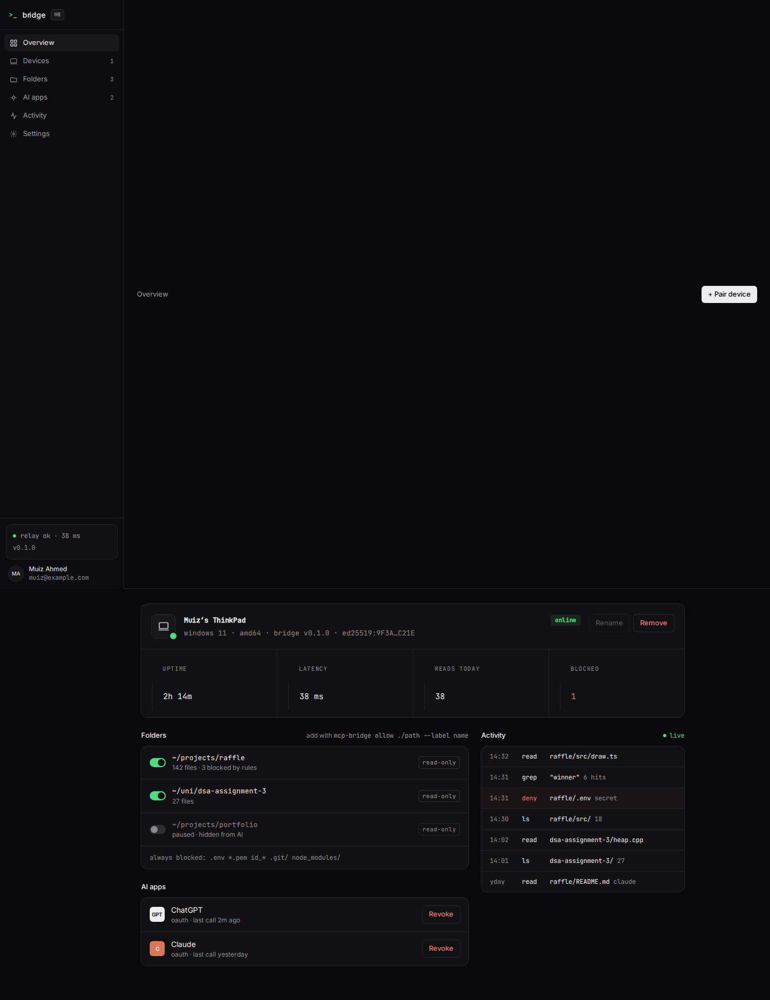
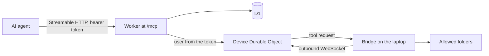

# mcp-bridge

A small program on a laptop keeps an outbound connection so an agent can read folders a student chose, without pasting the project into a chat.

The bridge is a single Go binary. It opens a WebSocket to a Cloudflare Worker, proves it holds the device key, and answers two read-only tools: `list_files` and `read_file`. The allowlist is enforced on the laptop. The server stores folder labels, not paths, and it cannot add a directory the bridge does not already have.

This repository is the phase 1 slice: the bridge, the Worker and its Durable Object, a minimal control panel, and the protocol they share. It is MIT licensed and meant to be self-hosted.

## Control panel

The panel is a dark terminal layout. These are the landing, pair, and dashboard screens:




`scripts/e2e-full.mjs` runs the live path (pairing, sockets, and tool calls) against a local worker. The matrix is [docs/TEST-MATRIX.md](docs/TEST-MATRIX.md).

## Architecture



The laptop dials out. Nothing on the laptop accepts inbound connections. The agent never sends a device id that the server trusts: the bearer token is resolved to a user, and the worker picks that user's connected device.

More detail is in [docs/ARCHITECTURE.md](docs/ARCHITECTURE.md), [docs/PROTOCOL.md](docs/PROTOCOL.md), and [docs/SECURITY-MODEL.md](docs/SECURITY-MODEL.md).

## Repository

| Path              | What it is                                                   |
| ----------------- | ------------------------------------------------------------ |
| `apps/bridge`     | Go binary. Pairing, reconnect, and the filesystem boundary.  |
| `apps/worker`     | Cloudflare Worker, one SQLite Durable Object per device, D1. |
| `apps/web`        | Control panel scaffold: landing, pair, dashboard.            |
| `packages/shared` | Protocol types, canonical JSON, pairing-code rules.          |
| `docs`            | Design, threat model, decisions, roadmap.                    |

## Local test

You need Node.js 22, pnpm 10, and Go 1.22. These steps were run against `wrangler dev` on this machine: a paired bridge answered `read_file` for an allowed text file and refused `.env` and a symlink that left the folder.

```bash
pnpm install
cp apps/worker/.dev.vars.example apps/worker/.dev.vars
pnpm --filter @mcp-bridge/worker exec wrangler d1 migrations apply mcp-bridge --local
```

Terminal 1, the worker:

```bash
pnpm dev:worker
```

Wait until it prints `Ready on http://127.0.0.1:8787`.

Terminal 2, the control panel (optional, for the browser):

```bash
pnpm dev:web
```

Open http://localhost:5173. Google sign-in stays off until client credentials exist. On localhost, use **Use a local development session**, then enter the pairing code.

Terminal 3, the bridge. Pick an empty config directory so you do not touch a real one:

```bash
export MCP_BRIDGE_HOME=/tmp/mcp-bridge-home
mkdir -p /tmp/demo-notes
printf 'hello from the bridge\n' > /tmp/demo-notes/hello.txt
printf 'SUPERSECRETVALUE\n' > /tmp/demo-notes/.env

cd apps/bridge
go run ./cmd/bridge --server http://127.0.0.1:8787 allow /tmp/demo-notes --label notes
go run ./cmd/bridge --server http://127.0.0.1:8787
```

The process prints a code such as `AB3D-EF2H`. Pair it. With the worker in development mode the shortest path is:

```bash
curl -sS -X POST http://127.0.0.1:8787/api/dev/pair \
  -H 'content-type: application/json' \
  -d '{"code":"AB3D-EF2H"}'
```

That returns a bearer token for the local development user and marks the device active. The bridge then prints `Connected.`

Approve the folder. The response above is the only time the token is shown by that call; save it as `TOKEN`.

```bash
curl -sS http://127.0.0.1:8787/api/folders -H "authorization: Bearer $TOKEN"
curl -sS -X POST "http://127.0.0.1:8787/api/folders/FOLDER_ID/approval" \
  -H "authorization: Bearer $TOKEN" -H 'content-type: application/json' \
  -d '{"approval":"approved"}'
```

Call the MCP endpoint the way an inspector would. Streamable HTTP here answers a single JSON body.

```bash
curl -sS -D - http://127.0.0.1:8787/mcp \
  -H "authorization: Bearer $TOKEN" \
  -H 'content-type: application/json' \
  -H 'accept: application/json, text/event-stream' \
  -d '{"jsonrpc":"2.0","id":1,"method":"initialize","params":{"protocolVersion":"2025-03-26","capabilities":{},"clientInfo":{"name":"curl","version":"0"}}}'
```

Copy `mcp-session-id` from the response headers, then:

```bash
curl -sS http://127.0.0.1:8787/mcp \
  -H "authorization: Bearer $TOKEN" \
  -H 'content-type: application/json' \
  -H 'accept: application/json, text/event-stream' \
  -H 'mcp-protocol-version: 2025-03-26' \
  -H "mcp-session-id: SESSION_ID" \
  -d '{"jsonrpc":"2.0","id":2,"method":"tools/call","params":{"name":"read_file","arguments":{"folder":"notes","path":"hello.txt"}}}'
```

`hello.txt` returns `hello from the bridge`. The same call with `path` set to `.env`, or to a symlink that points outside the folder, returns an error and does not return file contents. `list_files` omits denylisted names.

`scripts/e2e-local.sh` runs that sequence against a worker that is already up. It is not part of CI.

MCP Inspector can use the same URL, `http://127.0.0.1:8787/mcp`, with header `Authorization: Bearer TOKEN`. Access tokens last 45 minutes. Create another from the dashboard or from `POST /api/tokens`.

Development sign-in exists only when `DEV_AUTH=true` and the request host is localhost. Do not set `DEV_AUTH` on a public deployment.

## Self-hosting

The hosted shape is a free Cloudflare account: one Worker, SQLite-backed Durable Objects, and one D1 database. Tokens live in D1. KV is intentionally unused because the free plan allows very few writes per day.

1. Create a D1 database named `mcp-bridge` and put its id in `apps/worker/wrangler.toml`.
2. Set `WEB_ORIGIN` and `PUBLIC_BASE_URL` to the public origins. Leave `DEV_AUTH` unset.
3. To turn on Google sign-in, set `GOOGLE_CLIENT_ID` and `GOOGLE_CLIENT_SECRET`. The redirect URI is `{PUBLIC_BASE_URL}/api/auth/google/callback`.
4. Apply migrations and deploy with the manual workflow in `.github/workflows/deploy.yml`, or locally:

```bash
pnpm --filter @mcp-bridge/worker exec wrangler d1 migrations apply mcp-bridge --remote
pnpm --filter @mcp-bridge/worker exec wrangler deploy
```

5. Build the control panel with `pnpm --filter @mcp-bridge/web build` and host `apps/web/dist` on any static host whose origin matches `WEB_ORIGIN`. The Worker does not serve the panel in this phase.

`users.status` is ordinary account state: `active` or `suspended`. The worker refuses suspended accounts. There is no endpoint that changes it.

Point the bridge at the deployment:

```bash
mcp-bridge --server https://mcp.muiz.pk
```

Agents use `https://mcp.muiz.pk/mcp`.

## Development

```bash
pnpm install
pnpm lint
pnpm typecheck
pnpm test
```

`pnpm test` runs the TypeScript tests and `go test ./...` in `apps/bridge`. CI also runs `golangci-lint`. Go is formatted with `gofmt`.

Bridge commands:

```text
mcp-bridge allow <directory> --label notes
mcp-bridge unallow notes
mcp-bridge folders
mcp-bridge status
mcp-bridge version
```

Config and the device key live in `$MCP_BRIDGE_HOME`, or in the user config directory under `mcp-bridge` when that variable is unset. The key file is mode `0600`.

## Security

Report vulnerabilities privately. See [SECURITY.md](SECURITY.md). The threat model, including stolen tokens, prompt injection, and cross-tenant routing, is [docs/SECURITY-MODEL.md](docs/SECURITY-MODEL.md).

## License

[MIT](LICENSE).
